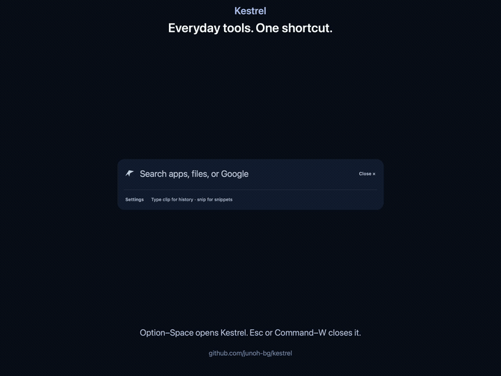

<p align="center"></p>

# Kestrel

**Make everyday work immediate, predictable, and personal.**

A native Mac launcher for opening apps, finding files and folders, searching Google, calculating, and reusing copied text and saved snippets—all from **Option–Space**. Five themes. Local storage. No account required.

**macOS 14+ · Apple silicon · Free and open source**

## Install

### Set up with an AI agent

Use **Claude Code, Codex, or another coding agent on your Mac**? Paste this prompt:

```text
Install Kestrel from https://github.com/junoh-bg/kestrel.
Read README.md and docs/agent-setup.md, check my Mac's compatibility,
and use the published app ZIP unless I ask to build from source.
Verify the download checksum, preserve any existing Kestrel data,
install the app, and help me test Option–Space. If macOS blocks the
unnotarized preview, explain the warning and guide me through the
per-app Open Anyway steps; leave security approvals to me.
Keep clipboard history off unless I opt in. Report the installed
version, checks completed, and any unfinished steps.
```

The agent can handle installation, but macOS may still require **your approval**. A browser-only chat can guide you but cannot install the app. [Agent setup guide](docs/agent-setup.md).

### Download and install yourself

[**Download Kestrel for Mac (.zip)**](https://github.com/junoh-bg/kestrel/releases/download/v1.7.0/Kestrel-1.7.0-macos-arm64.zip)

v1.7.0 preview · [Release notes](https://github.com/junoh-bg/kestrel/releases/tag/v1.7.0) · [SHA-256 checksum](https://github.com/junoh-bg/kestrel/releases/download/v1.7.0/Kestrel-1.7.0-macos-arm64.zip.sha256)

1. Unzip the download and drag **Kestrel.app** into **Applications**.
2. Open Kestrel. If macOS blocks it, follow the steps below.
3. Press **Option–Space**. If another launcher uses that shortcut, quit it or change its shortcut.

#### macOS first-launch warning

**This preview is not Apple-notarized.** You may see a warning that Apple cannot check Kestrel for malicious software or cannot verify its developer. For a copy you trust from this repository:

1. Attempt to open Kestrel, then dismiss the warning without moving it to Trash.
2. Open **System Settings → Privacy & Security**, scroll to **Security**, and click **Open Anyway** for Kestrel.
3. Complete any authentication and confirm **Open** when prompted.

No deletion or rebuild is needed for this approval. If your work Mac does not allow it, contact IT. If the warning says the app **will damage your computer** or **is damaged**, stop and [report the exact message](https://github.com/junoh-bg/kestrel/issues). [Apple’s guidance](https://support.apple.com/en-us/102445) · [Setup help](docs/getting-started.md#first-launch).

### Build from source

Requires Xcode command-line tools with Swift 6+ and Python 3. [Build guide](docs/development.md).

```sh
git clone https://github.com/junoh-bg/kestrel.git
cd kestrel
./scripts/package.sh
```

The script creates `dist/Kestrel.app`; it does not install it. Quit Kestrel, move the built app into **Applications**, replace the previous app if present, and open it. Saved data is kept separately. A local build does not notarize the published ZIP.

### Updating

**Upgrading to 1.7.0:** if you enabled Full Disk Access before, macOS may need one final approval for Kestrel’s new signing identity. [One-time permission steps](docs/getting-started.md#one-time-permission-refresh-for-170).

If your wing menu has **Check for Updates…**, use it to download and install a newer version. Automatic checks can be turned off in **Settings → General**; installation always asks first.

Version 1.5.0 and earlier need one manual upgrade to receive this feature: quit Kestrel, replace the app in Applications with the newer download, and reopen it. Your saved settings and snippets remain intact.

## Demo



[Watch or download the short demo (MP4)](docs/demo/kestrel-demo.mp4) · 43-second English walkthrough of search, daily tools, themes, and in-app updates using sample data. Background blur varies with your desktop and accessibility settings.

## Use

Type an app or folder name, `dev/docs`, `file report`, a Google query, `= 12 * 8`, `clip meeting`, or `snip signature`. Use **↑ / ↓** to select, **Return** to open or copy, and **Esc / ⌘ W** to dismiss. **⌘ K** opens actions for the selected result, such as Show in Finder or Copy Path.

Open **Settings** from the wing menu to choose a theme, manage snippets, or enable optional clipboard history. File search uses Spotlight and may need folder access. Clipboard history starts off and stores unencrypted text locally when enabled. Selecting Google search sends that query to your browser; Kestrel has no telemetry or cloud sync. Update checks contact GitHub for release information.

[Setup & help](docs/getting-started.md) · [Release notes](CHANGELOG.md) · [Report an issue](https://github.com/junoh-bg/kestrel/issues) · [MIT license](LICENSE)
