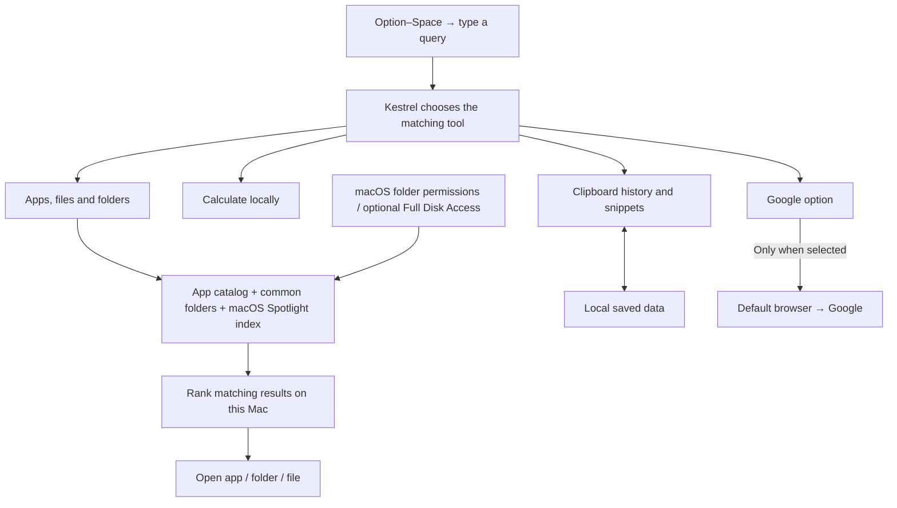
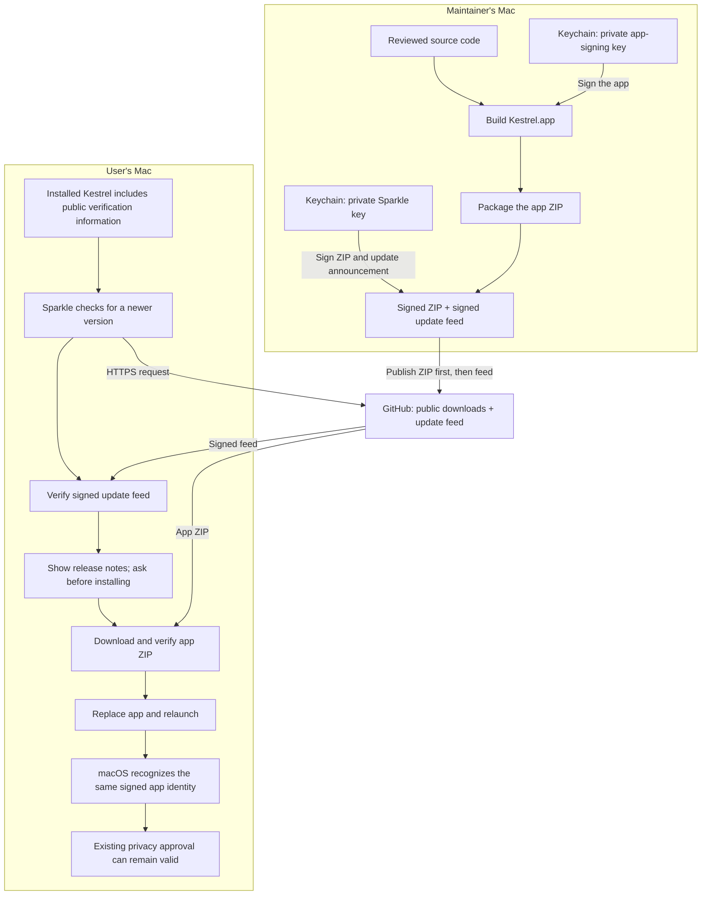

# How Kestrel works

Kestrel runs on each user's Mac. GitHub hosts downloads and update announcements. The maintainer's Mac prepares releases; it does not need to stay online for people to use or update Kestrel.

## Everyday use

Nested-path searches first find matching parent folders, then their children. `dev/docs` means a `docs` folder directly inside `dev`; indexing and permissions still apply. Results put applications before folders, then files and other actions. Ranking within each type uses match quality and local usage history. Search text is not executed as a command.

Clipboard capture is optional and starts off. Settings, snippets, learned ranking, and enabled history stay in local storage; there is no Kestrel account, telemetry, or cloud sync. Selecting Google search sends that query to the browser and Google. Update checks contact GitHub but do not send search queries, snippets, or clipboard history.

## From a release to another laptop

If signature verification fails, Sparkle rejects the update. Checks can happen automatically while Kestrel runs, or through **Check for Updates…**. Installation always requires the user's consent. Versions 1.5.0 and earlier need a manual upgrade because they do not contain Sparkle.

## Why two keys?

| Item | Stored where | What it does |
| --- | --- | --- |
| Private app-signing key, `Kestrel Code Signing` | Maintainer's login Keychain only | Signs the app so macOS can recognize the same identity across builds. |
| Public app certificate and identity requirement | Embedded in the signed app; public fingerprints in the repository | Lets macOS check continuity without possessing the private key. |
| Private Sparkle update key, account `junoh-bg.kestrel` | Maintainer's login Keychain only | Signs the downloadable ZIP and the update feed. This is the key created first. |
| Public Sparkle verification key | Built into every updater-enabled Kestrel app | Lets every user's Mac verify that downloads were signed by the matching private key and have not changed. |
| Full Disk Access approval | Each user's macOS privacy system | Records that user's permission for the app identity. It is separate from both private keys. |

A private key creates a signature; its public counterpart checks that signature without being able to create one. Keychain protects the private keys and controls which signing tools may use them. The approved signing tools use these keys; no private key is put in Git, the ZIP, or the user's Keychain. Users need no developer account or certificate setup, and their Macs never contact the maintainer's laptop for approval.

App signing answers **“Is this the same app identity?”** Sparkle signing answers **“Is this update authentic and unchanged?”** These are separate checks, so the two keys are separate. A downloaded SHA-256 checksum is an additional consistency check, not a private key.

## What changed in 1.7.0?

Older ad-hoc signatures changed identity for each build. Starting with 1.7.0, official releases use the same certificate and bundle identifier. The transition can require one final Full Disk Access approval; see the [upgrade instructions](getting-started.md#one-time-permission-refresh-for-170).

A real signed Sparkle update retained Full Disk Access on macOS 27.0.1. Another Mac without the maintainer certificate and older supported macOS versions still need testing. Replacing the certificate or installing an ad-hoc source build can change the identity again.

Self-signing is free, but it does not provide Apple notarization or remove the first-install warning. Apple Developer ID/notarization is a separate distribution improvement, not a requirement for hosting this open-source preview on GitHub.
