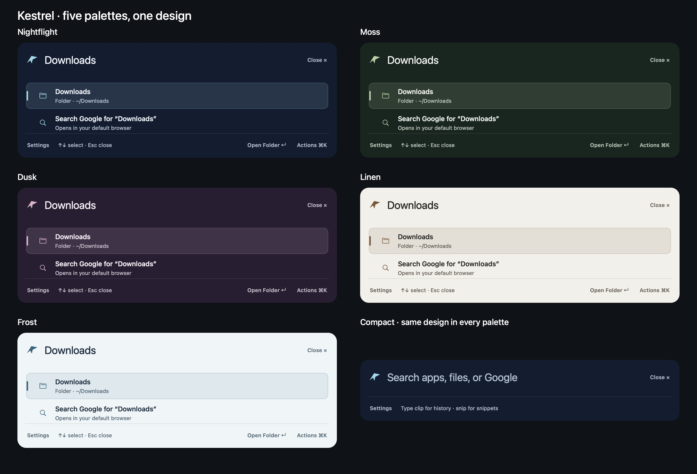

# Kestrel design evolution

Direction confirmed: smoked navy glass, with alternative palettes that retain one coherent design philosophy.

## Product principle

Find something, understand it, act on it. Kestrel is a small native Mac utility with predictable keyboard behavior and local storage. Visual polish should reduce friction, rather than add a new dashboard or require more permissions.

## First pass

- One compact search surface; expand to fit results with a bounded maximum height and a stable top edge.
- Keep the wing as a quiet identity mark, clear primary text, subordinate paths, and restrained selection color.
- A contextual action bar names what Return will do. Command–K offers useful secondary actions for the selected item, including Show in Finder and Copy Path for local results.
- One shared material, spacing, corner, type, and control system for launcher and settings. Honor Reduce Transparency with a fully opaque fallback.
- Replace all five palettes: Nightflight (navy/ice), Moss (forest/sage), Dusk (plum/rose), Linen (warm light/umber), Frost (cool light/slate). Preserve persisted theme identifiers so upgrades retain the user's chosen family.
- No change to search scopes, clipboard opt-in, ranking rules, or personal-data storage.

## Research informing the direction

Raycast's documented search and contextual actions make secondary operations discoverable at the selected result. Its compact mode and immediate theme previews are useful interaction patterns. Apple describes Spotlight as a search-and-action surface and its modern material as translucent. The implementation below uses standard AppKit materials compatible with macOS 14; it does not claim to reproduce Apple's Liquid Glass rendering.

Public references:
- https://manual.raycast.com/search-bar
- https://manual.raycast.com/action-panel
- https://manual.raycast.com/themes
- https://manual.raycast.com/file-search
- https://www.apple.com/newsroom/2025/06/macos-tahoe-26-makes-the-mac-more-capable-productive-and-intelligent-than-ever/
- https://developer.apple.com/design/human-interface-guidelines/materials

## Verification

Regression checks for compact/expanded search, stable selection during asynchronous results, contextual actions, isolated clipboard copies, live theme transitions, and opaque accessibility fallback. Check all palettes at the minimum settings width. Build/package checks and an isolated native visual harness precede any installation. Do not replace published release assets.

## Follow-up candidates

Favorites and aliases, optional Quick Look, a configurable launcher shortcut, and theme customization. Evaluate each by the keystrokes it saves; an extension marketplace or cloud AI service is outside this first pass.

## Review result

The first pass is implemented on `feat/smoked-glass-design`. All five palette families use the same layout, controls, selection treatment, and AppKit material. Persisted palette IDs remain compatible with existing preferences. Option–Space still opens Kestrel; Escape and Command–W dismiss it. Command–K adds actions for the selected result.

These are captures of the native views with the opaque accessibility fallback enabled, so palette comparison does not depend on desktop wallpaper. The translucent surface was separately inspected in the running preview.

Review found and fixed low-contrast selected folder icons in light themes, stale actions after deselection, and Command shortcuts receiving Hangul characters when Korean input is active. Menu actions capture their result and query so asynchronous search updates cannot retarget an already-open menu.

Verification on the development Mac:

- 71 Swift tests passed (12 core, 59 native), including asynchronous search selection, isolated clipboard actions, all-palette contrast and controls, opaque fallback, and Korean-input shortcuts.
- Three packaging tests passed; release build, app packaging, signature verification, packaged smoke test, strict Swift formatting lint, and `git diff --check` passed.
- Native launcher and minimum-width Settings captures inspected for all five palettes. Live checks confirmed the glass surface, arrow-key selection, click-open actions, and Command–K with Korean input. Native automation subsequently timed out, so final live Command–W and Settings-click checks were not completed; their native regression tests passed.

This branch is a design review candidate. It has not replaced the installed app or published a new release. The existing downloadable preview and its demo remain unchanged. Before distributing this design, assign a new minor version/build, prepare its release notes and updated demo, and validate the packaged app on the supported macOS versions. No proprietary reference code or assets are included.
